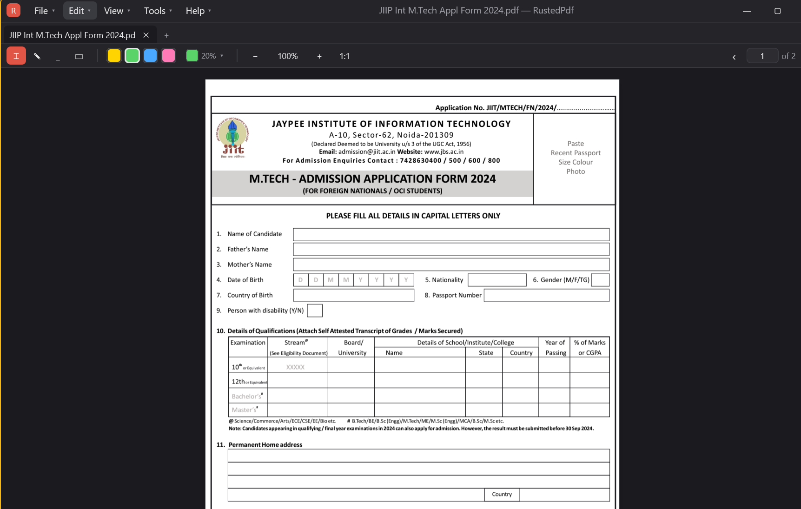
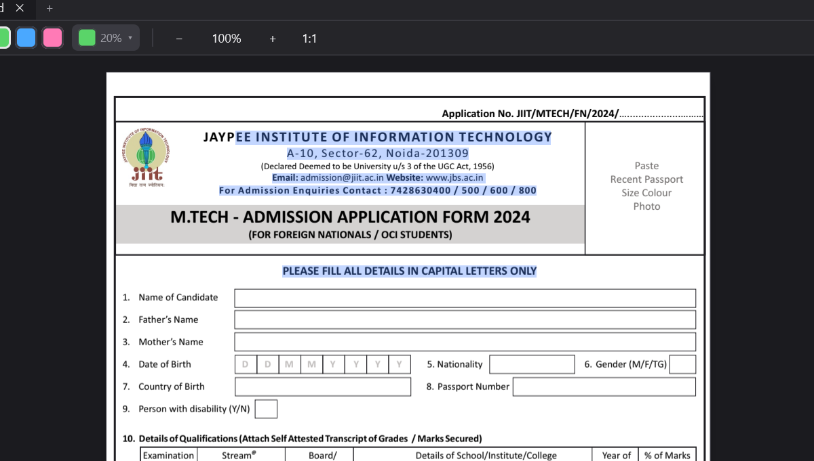

# RustedPDF — a fast PDF reader and highlighter in Rust

[](Cargo.toml)
[](https://www.rust-lang.org/)
[](https://crates.io/crates/gpui)
[](#platform-notes)
[](PACKAGING.md#portable-alternative)
[](LICENSE.md)

A cross-platform PDF reader and highlighter in Rust, built on
[GPUI](https://crates.io/crates/gpui) and [PDFium](https://pdfium.googlesource.com/pdfium/).
The custom titlebar carries the navigation menu and the window buttons on one
strip, and is packaged as a component you can lift into another GPUI app.

## Screenshots


*The main window: menus and window buttons share one titlebar, with tabs, tools, colours, zoom and the page box below.*


*Selection follows reading order across lines — Ctrl+C copies it with line breaks and spaces intact.*

## Running

```sh
cargo run                 # or: cargo run -- path/to/file.pdf
cargo test                # PDFium round-trip tests
```

`vendor/pdfium/` holds the PDFium shared library; [build.rs](build.rs) copies it
next to the executable on every build. See
[vendor/pdfium/README.md](vendor/pdfium/README.md) to refresh it or add another
platform.

To build a Windows installer that ships the app **and** the PDFium library
together, `cargo wix` — see [PACKAGING.md](PACKAGING.md).

## What it does

**Reading** — multi-tab (only PDFs open; a mis-named or non-PDF file is refused
with a clear message), continuous scroll, zoom 50%–200%. `Ctrl`+wheel and a
touchpad pinch zoom smoothly about the pointer. Clicking the file name in the
status bar shows the file in Explorer. Only the pages in view
are rasterised, and the rest of the cache is dropped each frame.

**Marking** — drag with the highlighter (✎) or underliner to mark a run of
text; the drag is previewed in the mark's own colour. Drag the eraser (▭)
across marks to remove everything it passes over. Marks follow reading order,
so dragging from mid-line to mid-line marks the text between, one box per line.
Right-click for Copy, Select All (`Ctrl+A`), marking or un-marking the
selection, and the tools.

* Highlights are **multiplied** into the page pixels, not drawn over them:
  paper takes the colour, glyphs stay black. Highlighted text is exactly as
  legible as unhighlighted text.
* A new mark **replaces** any mark of the same kind it overlaps, so colours
  can't stack up and darken the words underneath.
* Marking over part of an existing mark takes over **only the part it covers** —
  the old mark is trimmed back to the words the new one doesn't touch, so
  recolouring one word inside a highlighted sentence leaves the rest alone.
* Any `0xRRGGBB` colour works. The toolbar has four quick swatches; the colour
  chip beside them opens a dropdown (not a dialog — it's an adjustment you make
  while reading) with presets, every hue at four strengths, and a transparency
  setting whose steps preview the actual colour over paper.

**Selecting** — drag with the Select tool, or just mark some text; either way
`Ctrl+C` copies it, with line breaks preserved and spaces reconstructed from the
gaps PDFs leave between glyphs. Copying clears the selection, the way a text
field does; switching tools keeps it.

A selection follows reading order rather than the rectangle you dragged, so
dragging from the middle of one line to the middle of another takes the run
between them — and that holds across page breaks. Drag past the bottom of the
window and the column scrolls after you, faster the further out you go, until
you let go or reach the end of the document; a paragraph that runs over onto
the next page selects in one gesture. Pages with no text (a divider, a
full-page figure, a scan) contribute nothing rather than stopping the run at
them. Highlighting a selection that crossed a break makes one mark run per
page, because that is how marks are stored and written back.

**Getting around a long document** — the page column has a real scrollbar down
its right edge: drag the thumb to cross a five-hundred-page book in one
gesture, or press anywhere on the track to jump there. The wheel still works
over it. The toolbar's page box is both the counter and the way to move: `‹`
and `›` step a page, and clicking the number (or `Ctrl+G`) lets you type one —
Enter goes there, Escape leaves you where you were. View ▸ *First Page* and
*Last Page* are the two ends.

**Exporting** — File ▸ Export Pages… (`Ctrl+E`) opens a dialog: tick the pages
you want, choose PNG or PDF, and pick a destination. One page as PNG writes a
single image; several write a `.zip` of `page-001.png`, `page-002.png`, … PDF
writes a new document containing only those pages. Marks are included either
way, and the open document is left untouched.

**Saving** — marks are written into the PDF as real `/Highlight` and
`/Underline` annotations, so other viewers see them. The file is written beside
the original and moved into place, so a failure part-way through can't leave a
truncated PDF. Nothing is written until you ask.

**Closing** — closing a tab or the window with unsaved marks puts up a dialog
listing each affected document with a tick box: save the selected ones, save
all, close without saving, or cancel.

**Open with** — Settings ▸ *File manager* registers RustedPdf as a PDF handler,
so right-clicking a PDF in the file manager offers it. Registration is
per-user, additive and reversible: it appears in the "Open with" list without
becoming the default, needs no administrator rights, and *Remove* deletes
exactly what it wrote. Uninstalling removes it too — on Windows the uninstaller
runs `RustedPdf.exe --unregister-shell`, because the entry lives in `HKCU`
where a per-machine uninstall would never find it.

| Platform | What registering does |
| --- | --- |
| Windows | Writes a `RustedPdf.Document` ProgID under `HKCU\Software\Classes` and lists it in `.pdf\OpenWithProgids`, then tells Explorer to reload associations |
| Linux | Installs `~/.local/share/applications/rustedpdf.desktop` with `MimeType=application/pdf` and refreshes the desktop database |
| macOS | Not possible at runtime — Launch Services reads document types from the bundle. Add a `CFBundleDocumentTypes` entry for `public.pdf` to `RustedPdf.app/Contents/Info.plist` |

Register after `cargo build --release`, so the entry points at the binary you
mean to keep; if the executable later moves, Settings reports it as
unregistered so re-registering fixes the path. Each opened file starts its own
instance — there's no single-instance IPC yet.

**Recent files** — pruned on every load, every open and every record. An entry
whose file has been deleted or moved is dropped rather than kept as a dangling
path.

**After a crash** — a journal of unsaved marks is rewritten as you work and
deleted on a clean exit, so finding one at startup means the last session ended
badly. What happens then is a setting (Settings ▸ *Recover unsaved marks after
a crash*):

| Setting | Behaviour |
| --- | --- |
| off (default) | The marks are discarded and your PDFs are left byte-for-byte unchanged. |
| on | The documents are reopened with their marks restored — still unsaved. |

Either way nothing is written into a PDF without an explicit save.

**Modals** are genuinely modal: a full-window backdrop with `occlude()` blocks
every mouse event to the document, toolbar, tabs *and* titlebar, while focus and
the key context move to the dialog so no shortcut resolves behind it.

## Layout

| Path | Role |
| --- | --- |
| [src/ui/titlebar/](src/ui/titlebar/) | **Reusable** titlebar component — no PDF code |
| [src/pdf/](src/pdf/) | PDFium binding, rasterising, text, marks, saving |
| [src/app.rs](src/app.rs) | Workspace state and every command |
| [src/tab.rs](src/tab.rs) | One open document: zoom, scroll, page geometry |
| [src/view/](src/view/) | Rendering: viewer, toolbar, tabs, start screen, modals |
| [src/state/](src/state/) | Settings, recent files, crash journal |
| [src/integration.rs](src/integration.rs) | Per-user "Open with" registration, per OS |
| [assets/](assets/) | App icon: embedded in the exe, the installer and the file type |
| [wix/main.wxs](wix/main.wxs) | Windows installer — ships `pdfium.dll` with the app |
| [tests/pdf_backend.rs](tests/pdf_backend.rs) | End-to-end tests against real PDFium |

### Reusing the titlebar

[src/ui/titlebar/](src/ui/titlebar/) knows nothing about PDFs. To use it
elsewhere: copy the directory, open the window with
`window_options_titlebar(..)`, give your root view a `TitleBarState` field,
implement `TitleBarHost`, and render it:

```rust
impl TitleBarHost for Workspace {
    fn title_bar(&mut self) -> &mut TitleBarState { &mut self.title_bar }

    fn on_menu_command(&mut self, id: &'static str, label: &'static str,
                       window: &mut Window, cx: &mut Context<Self>) {
        self.run_command(id, window, cx);
    }

    // Return false to keep the window open — e.g. to prompt about unsaved work.
    fn on_close_requested(&mut self, _: &mut Window, cx: &mut Context<Self>) -> bool {
        let may_close = self.request_close_window();
        cx.notify();
        may_close
    }
}

TitleBar::new(self.window_title(), MENUS)
    .mark("R")
    .style(palette.titlebar_style())
    .menus_enabled(!modal_open)   // inert while a dialog is up
    .render(&self.title_bar, window, cx)
```

Menus are data ([src/menu.rs](src/menu.rs) is this app's tree) built from `cmd`,
`disabled`, `toggle`, `sub` and `SEP`; the component renders any depth of
nesting, so adding a submenu never touches UI code. Colours come from
`TitleBarStyle` and sizes from `TitleBarMetrics`, both plain structs with
`Default`.

## Platform notes

The window uses `appears_transparent: true` (client-side decorations), so the
app owns the whole strip.

* **Windows** — GPUI can't drag or restore a frameless window from the client
  area, so [window_ops.rs](src/ui/titlebar/window_ops.rs) posts the native
  messages (`WM_NCLBUTTONDOWN`/`HTCAPTION`, `WM_SYSCOMMAND` +
  `SC_MAXIMIZE`/`SC_RESTORE`) — the same path the taskbar button and `Win`+`↑`
  use. The three buttons are ordinary client elements: they must stay outside
  any caption region or the OS swallows the clicks.
* **macOS** — the native traffic lights are kept and positioned inside the bar;
  no custom buttons are drawn and the nav is inset to clear them.
* **Linux** — Wayland/X11 use GPUI's `start_window_move` / `zoom_window`.

PDFium is not thread-safe; the app only calls it from the UI thread, and the
test suite serialises for the same reason.

## Not built yet

OCR, sticky notes and drag-and-drop opening. Marking needs selectable text — a
scanned page without a text layer says so in the status bar rather than failing
silently.

## License

RustedPDF is free for personal, hobby, research and educational use under the
[PolyForm Noncommercial License 1.0.0](LICENSE.md). **Commercial use is not
permitted.**

The bundled PDFium library in [vendor/pdfium/](vendor/pdfium/) is third-party
software under its own licence; see [vendor/pdfium/LICENSE](vendor/pdfium/LICENSE).
